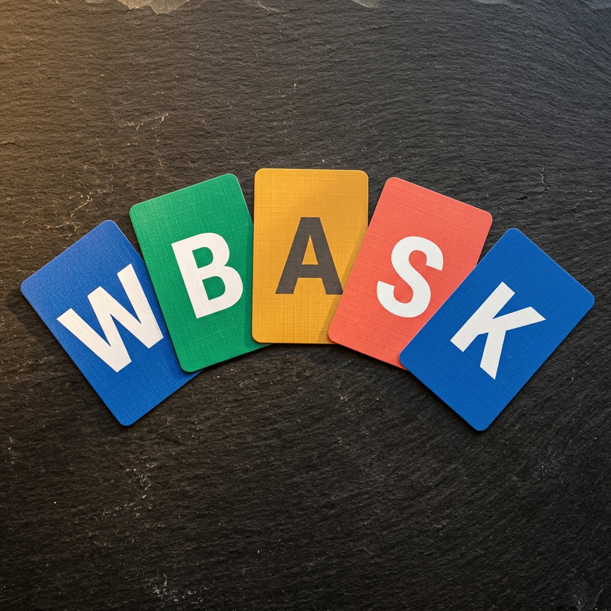

<div align="center">

# ⚡ WortBlitz

**Das rasante Echtzeit-Multiplayer-Wortkartenspiel für Familie, Freunde & Spieleabende**

[](#tech-stack)
[](#tech-stack)
[](#tech-stack)
[](#tech-stack)
[](#tech-stack)

[Spielprinzip](#-spielprinzip) • [Spielanleitung](#-spielanleitung) • [Sonderregeln & Karten](#-sonderregeln--spezialkarten) • [Tisch-Modus & KI-Bots](#-tisch-modus--ki-bots) • [Installation & Setup](#-installation--deployment)

<br />



</div>

---

## 🎯 Spielprinzip

**WortBlitz** bringt die Dynamik schneller Wort- und Reaktions-Kartenspiele (inspiriert von *NONSTOP CARDS*) direkt auf Smartphones, Tablets und Laptops:

* **Alle spielen gleichzeitig auf dem eigenen Gerät:** Jeder sieht nur seine eigene Hand aus Buchstabenkarten und tritt per **QR-Code** in Sekunden ohne App-Store-Download bei.
* **Sprechen oder tippen:** Passe einen Begriff oder einen sinnvollen kurzen Satz zum aktuellen Thema an einen deiner Handbuchstaben an – per **Spracherkennung** (*Push-to-Talk* oder *Dauer-Zuhören*) oder über die Tastatur.
* **KI-Schiedsrichter in Echtzeit:** **Google Gemini** prüft blitzschnell, ob der Begriff ein echtes deutsches Wort bzw. eine sinnvolle Aussage ist, zum Thema passt und noch nicht genannt wurde.
* **Solo & Familien-tauglich:** Spiele alleine gegen schlagfertige **KI-Bots** (*Blitz-Berta*, *Turbo-Toni* & Co.), aktiviere den **Junior-Modus** für jüngere Mitspieler oder nutze ein Tablet in der Tischmitte als großen **Tisch-Bildschirm mit Live-Moderation**.

---

## 🕹️ Spielanleitung

### 1. Raum erstellen & beitreten
1. **Zugang freischalten:** Mit dem gemeinsamen Familien-Passwort einloggen.
2. **Raum eröffnen:** Gastgeber wählt Themen-Deck (6 eingebaute Kategorien, *Bunter Familien-Mix*, eigene Decks oder KI-generierte Themen), Rundenzeit (`15s`, `20s`, `30s`) und Spielmodus.
3. **Beitreten per QR-Code:** Mitspieler scannen den QR-Code in der Lobby (automatischer Login) oder geben den 4-stelligen Raum-Code ein.
4. **Geheime Themen (optional):** Jeder Spieler kann vor dem Start bis zu **2 eigene Geheim-Themen** unbemerkt in den Kartenstapel schmuggeln.

### 2. Rundenablauf
1. Zu Rundenbeginn erhält jeder Spieler **8 Buchstabenkarten** (im **Junior-Modus: 7 Karten**).
2. Nach einem kurzen `3 – 2 – 1`-Countdown erscheint das aktuelle **Thema** (z. B. *Gemüsesorten*, *Urlaubspannen*, *Dinge im Kühlschrank*).
3. **Karte auswählen & Begriff nennen:**
   * Tippe eine Handkarte an (sie wird aktiv markiert) und sprich oder tippe ein passendes Wort oder einen sinnvollen Satz (z. B. Karte **`K`** → *„Koffer“* oder *„Koffer verloren“*).
   * Bei aktivem **Dauer-Zuhören** ordnet das Spiel deinen gesprochenen Begriff automatisch der passenden Handkarte zu.
4. Wer zuerst alle Handkarten ablegt, beendet die Runde und kassiert zusätzliche **Platzierungs-Bonuspunkte** (`1. Platz: +3 P.`, `2. Platz: +2 P.`, `3. Platz: +1 P.`). Wer zuerst **20 Gesamtpunkte** erreicht, gewinnt das Match.

### 3. Punkte & Strafpunkte

| Ereignis | Wirkung |
| :--- | :--- |
| ✅ **Gültiger Begriff / Satz** | Karte wird abgelegt, im Live-Ticker gesperrt und gibt **`+1 Punkt`** |
| ❌ **Falscher Anfangsbuchstabe** (z. B. *„Tasche“* bei gewählter Karte `K`) | Zählt als Fehlversuch: **`-1 Strafpunkt`** |
| ❌ **Ungültiger Begriff / Fantasiewort** (KI-Jury lehnt ab) | **`-1 Strafpunkt`** + optional **`+1 Strafkarte`** (wenn in Lobby aktiv) |
| ↩️ **Falsch verstanden / Rückgängig** | Macht den letzten eigenen Zug inkl. Karte und Punkt/Strafpunkt rückgängig |

---

## 🃏 Sonderregeln & Spezialkarten

### Besondere Buchstabenkarten

| Karte | Badge / Optik | Regel |
| :--- | :--- | :--- |
| **★ Joker** | Goldene Karte (`A–Z`) | Ersetzt **jeden beliebigen Anfangsbuchstaben** (`A–Z`). Beim *Dauer-Zuhören* wird der Joker automatisch geschont, solange eine normale Handkarte passt. |
| **`Q`, `X`, `Y`** | Hinweis `Im Wort` | Diese seltenen Buchstaben müssen **nicht am Wortanfang** stehen, sondern dürfen **irgendwo** im Begriff oder Satz vorkommen (z. B. *„Ta**x**i verpasst“* für `X`, *„Hand**y** im Pool“* für `Y`). |
| **🔄 Notfall-Tausch** | Button `Karte tauschen (1×)` | Einmal pro Runde darf jeder Spieler eine ausgewählte Karte ohne Punktabzug gegen einen neuen gängigen Buchstaben eintauschen. |

### Chaos-Aktionskarten (`Regel-Variante: Familien-Chaos`)
Im Chaos-Modus startet jeder Spieler pro Runde mit **2 unterschiedlichen Aktionskarten**:

| Karte | Name | Effekt |
| :---: | :--- | :--- |
| 🔄 | **Themen-Wechsel** | Tauscht sofort das aktuelle Thema aus und startet den Runden-Timer neu. |
| 🎁 | **Karten-Geschenk** | Schiebt einem gewählten Mitspieler **1 eigene Buchstabenkarte** auf die Hand. |
| ⚡ | **Zeit-Turbo** | Verkürzt den laufenden Countdown für alle sofort auf **5 Sekunden**. |
| ❄️ | **Eisblock** | Friert einen gewählten Mitspieler für **6 Sekunden** ein (Eingabe gesperrt). |
| 🛡️ | **Schutzschild** | Blockt wahlweise ein eingehendes **Karten-Geschenk**, einen **Eisblock** oder eine **Strafkarte (+1)** ab. |

---

## 🖥️ Tisch-Modus, Tisch-Ton & KI-Bots

> [!TIP]
> **Zentraler Tisch-Lautsprecher (`Tisch-Ton`):** Aktiviere auf einem Laptop oder Tablet in der Tischmitte oben den Schalter **„Tisch-Ton“**. Dann bleiben alle Smartphones am Tisch stumm, während das zentrale Tisch-Gerät über Firestore alle Highlights, Fehlversuche und Aktionskarten mit schlagfertiger Spielshow-Stimme kommentiert.

* **Tablet / Tisch-Bildschirm:** Beim Erstellen eines Raums kann das Host-Gerät als reiner Tisch-Bildschirm (ohne eigene Handkarten) gestartet werden – mit extra großer Themenanzeige, Live-Ticker und permanentem Beitritts-QR-Code.
* **KI-Bots (2–8 Spieler auffüllen):** Füge in der Lobby beliebig viele Bots (*Blitz-Berta*, *Turbo-Toni*, *Schlau-Sam*, *Wort-Willi* u. a.) in drei Geschwindigkeiten hinzu:
  * **Gemütlich** (`7–13 Sek.`)
  * **Normal** (`4–8 Sek.`)
  * **Blitzschnell** (`2–4 Sek.`)

---

## 🛠️ Tech-Stack

* **Frontend:** React 19, TypeScript, Vite, Tailwind CSS v4, Lucide Icons, `qrcode.react`, `canvas-confetti`
* **Echtzeit-Multiplayer & State:** Firebase Cloud Firestore (Transaktionen, Subcollections für `players`, `feed`, `events`, `secretThemes`)
* **KI-Schiedsrichter & Bot-Intelligenz:** Google Gemini (`gemini-3.8-flash`) über eigenen PHP-API-Proxy (`gemini.php`) mit Familien-PIN-Authentifizierung
* **Sprache & Audio:** Web Speech API (`SpeechRecognition` & `speechSynthesis`) + Web Audio API Synthesizer-Soundeffekte

---

## 🚀 Installation & Deployment

<details>
<summary><strong>1. Lokale Entwicklung starten</strong></summary>

```bash
git clone [https://github.com/schwarer2006/wortblitz.git](https://github.com/schwarer2006/wortblitz.git)
cd wortblitz
npm install
npm run dev
```

Für den Produktions-Build:
```bash
npm run build
```
Die fertigen Dateien liegen anschließend im Ordner `dist/`.

</details>

<details>
<summary><strong>2. Firebase einrichten (<code>firebase-config.json</code> & <code>firestore.rules</code>)</strong></summary>

1. Erstelle ein Firebase-Projekt mit **Cloud Firestore**.
2. Trage deine Web-App-Zugangsdaten in `public/firebase-config.json` (bzw. `firebase-config.json` im Webroot) ein:

```json
{
  "apiKey": "DEIN_FIREBASE_API_KEY",
  "authDomain": "DEIN_PROJEKT.firebaseapp.com",
  "projectId": "DEIN_PROJEKT_ID",
  "storageBucket": "DEIN_PROJEKT.appspot.com",
  "messagingSenderId": "DEINE_SENDER_ID",
  "appId": "DEINE_APP_ID"
}
```

3. Hinterlege die Sicherheitsregeln aus `firestore.rules` in der Firebase Console unter **Firestore Database → Regeln** (inklusive automatischer 12-Stunden-Raumbereinigung).

</details>

<details>
<summary><strong>3. Server-Proxy für Gemini & Familien-PIN (<code>gemini.php</code>)</strong></summary>

> [!IMPORTANT]
> Der Gemini-API-Key und das Familien-Passwort liegen **niemals** im Frontend-Bundle, sondern ausschließlich serverseitig in `gemini.php` im selben Verzeichnis wie die `index.html`.

`gemini.php` nimmt `POST`-Requests im JSON-Format entgegen:
* **Login-Prüfung:** `{ "action": "auth", "pin": "..." }`
* **KI-Anfragen:** `{ "pin": "...", "prompt": "...", "jsonMode": true, "model": "gemini-3.8-flash" }`

</details>
